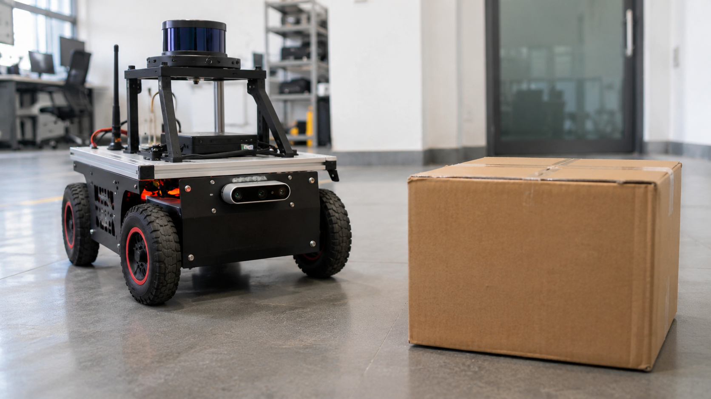
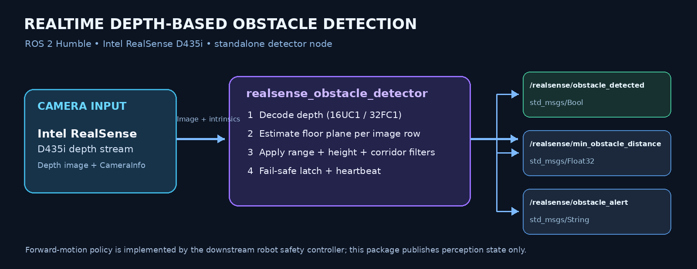
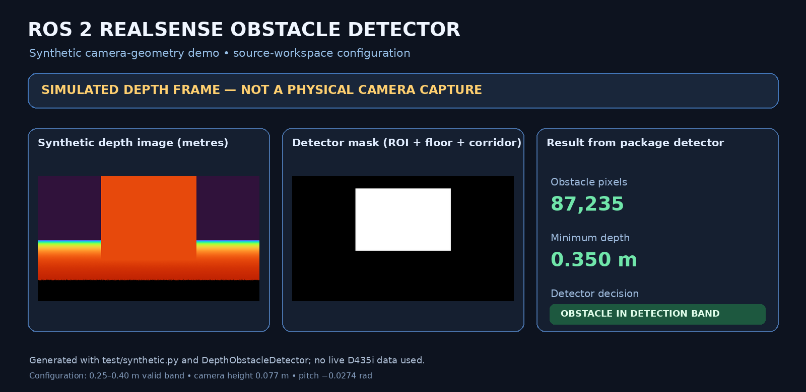

# ROS 2 RealSense Obstacle Detector

A standalone ROS 2 Humble package for close-range obstacle detection using the Intel RealSense D435i depth stream. It estimates whether valid depth returns inside the configured travel corridor indicate an obstacle above the floor, then publishes a fail-safe obstacle state and minimum distance.

> **Maintainer:** E MADAN KUMAR  
> **Repository:** `ros2-realsense-obstacle-detector`  
> **ROS 2:** Humble  |  **OS target:** Ubuntu 22.04  |  **Camera:** Intel RealSense D435i

## Project visuals

The repository includes a generated illustrative lab-scene visual and an algorithm-generated depth/mask example. They are visual aids, not photographs or measurements captured from a physical D435i. Use your own camera captures for claims about real hardware validation.







## Features

- Subscribes to `sensor_msgs/Image` depth frames (`16UC1`, `mono16`, or `32FC1`) and `sensor_msgs/CameraInfo`.
- Uses the actual camera intrinsics to build a row-wise floor model.
- Filters by minimum valid depth, configured detection distance, vertical height above the floor, and lateral robot corridor.
- Handles row padding and byte order when decoding depth messages.
- Uses a fail-safe latch: startup, stale streams, invalid/occluded depth, missing camera info, and processing failures remain blocked.
- Uses hysteresis and a clean-frame/hold-time requirement to avoid stop-go chatter.
- Publishes obstacle state, minimum distance, and a diagnostic alert.
- Supports validated runtime tuning of geometric and latch parameters.

## Repository layout

```text
ros2-realsense-obstacle-detector/
├── README.md
├── LICENSE
├── .gitignore
├── assets/
│   ├── illustrative_lab_scene.png
│   └── synthetic_depth_detection.png
├── docs/
│   └── CAMERA_SETUP.md
└── src/
    └── realsense_obstacle_detector/
        ├── config/
        ├── launch/
        ├── realsense_obstacle_detector/
        ├── resource/
        ├── test/
        ├── package.xml
        └── setup.py
```

**The `src/` directory intentionally contains only `realsense_obstacle_detector`.** The RealSense camera driver is an external ROS 2 dependency and is not vendored here.

## Camera configuration

The standalone YAML is `src/realsense_obstacle_detector/config/realsense_obstacle_detector.yaml`. It contains the configured D435i depth topic and installation geometry used for this detector deployment. These are installation-specific values, not universal RealSense defaults.

| Parameter | Value | Meaning |
|---|---:|---|
| `detection_distance` | `0.40 m` | Far edge of detector range |
| `min_valid_depth` | `0.25 m` | Ignores very-near returns |
| `camera_height` | `0.077 m` | Lens height above the floor |
| `camera_pitch` | `-0.0274 rad` | Source workspace floor-fit estimate |
| `depth_image_topic` | `/camera/camera/depth/image_rect_raw` | Depth input topic |
| `camera_info_topic` | derived | Defaults to `/camera/camera/depth/camera_info` |
| `corridor_half_width` | `0.45 m` | Lateral travel corridor half-width |

These are **installation-specific settings, not universal D435i defaults**. Re-measure camera height/pitch and tune the corridor for the target robot before enabling motion. The RealSense ROS 2 driver is a separate dependency; this repository does not vendor or invent a driver profile.

## Dependencies

- ROS 2 Humble (`rclpy`, `sensor_msgs`, `std_msgs`, `rcl_interfaces`, `tf2_ros`, `launch`, `launch_ros`)
- `python3-numpy`
- Intel RealSense ROS 2 wrapper package `realsense2_camera`
- Intel RealSense D435i connected and visible to the host

The RealSense wrapper is maintained separately. Its current ROS 2 instructions and topic examples are in the [official RealSense ROS 2 wrapper repository](https://github.com/realsenseai/realsense-ros). The source workspace's topic convention (`camera_namespace:=camera`, `camera_name:=camera`) yields `/camera/camera/depth/image_rect_raw` and `/camera/camera/depth/camera_info`. Verify with `ros2 topic list` on your machine.

## Build

```bash
source /opt/ros/humble/setup.bash
cd ~/ros2-realsense-obstacle-detector
rosdep install --from-paths src --ignore-src -r -y
colcon build --symlink-install --packages-select realsense_obstacle_detector
source install/setup.bash
```

## Run

Terminal 1 — start the RealSense driver (the wrapper must be installed):

```bash
source /opt/ros/humble/setup.bash
ros2 launch realsense2_camera rs_launch.py camera_namespace:=camera camera_name:=camera
```

Terminal 2 — start this detector: 

```bash
source /opt/ros/humble/setup.bash
cd ~/ros2-realsense-obstacle-detector
source install/setup.bash
ros2 launch realsense_obstacle_detector realsense_obstacle_detector.launch.py
```

The detector starts in the blocked state and only clears after valid, sufficiently clear depth frames have been processed. This is intentional fail-safe behavior.

## Published topics

| Topic | Message type | Meaning |
|---|---|---|
| `/realsense/obstacle_detected` | `std_msgs/msg/Bool` | `true` means forward motion should be inhibited |
| `/realsense/min_obstacle_distance` | `std_msgs/msg/Float32` | Nearest obstacle Z-depth in metres; `-1.0` when unavailable/no obstacle |
| `/realsense/obstacle_alert` | `std_msgs/msg/String` | Reason while blocked |

The node also subscribes to the configured depth image and CameraInfo topics.

## Useful commands

```bash
ros2 topic list | grep camera
ros2 topic echo /realsense/obstacle_detected
ros2 topic echo /realsense/min_obstacle_distance
ros2 topic echo /realsense/obstacle_alert
ros2 param list /realsense_obstacle_detector
```

## Regenerating the technical visuals

The synthetic depth/mask image is generated from the package's `test/synthetic.py` helper and the same `DepthObstacleDetector` class used by the ROS node:

```bash
python3 -m pip install numpy opencv-python pillow
python3 tools/generate_synthetic_demo.py
python3 tools/generate_architecture_diagram.py
```

The lab scene in `assets/illustrative_lab_scene.png` is AI-generated concept artwork; it is not a photograph of this project running on a physical robot.

## Tests

The depth geometry and safety latch are deliberately ROS-independent and can be tested without a camera: 

```bash
cd src/realsense_obstacle_detector
python3 -m pytest -q test/test_depth_detection.py test/test_safety_state.py
```

The optional `test_ros_integration.py` checks downstream safety-gate integration when the required ROS packages are installed in the sourced environment; it is skipped when those optional integration dependencies are unavailable.

## Validation status

- Offline detector/safety tests: **48 passed**.
- Optional ROS 2 safety-gate integration test: **1 skipped** because the external AMR safety-gate package is not part of this one-package repository.
- Python package metadata and XML manifest checks: passed.
- Full `colcon build` and live D435i validation: **not run here**, because this preparation environment does not have ROS 2 Humble or the camera connected. Run the build and hardware checks on the target Ubuntu 22.04 / ROS 2 Humble system before relying on the output for robot motion.

## Safety notes

- A generated image or synthetic depth frame is not evidence of real-world detection performance. Test with the actual D435i in a controlled area before connecting the output to a motion controller.
- Validate camera intrinsics, height, pitch, TF frames, depth topic, and the travel corridor on the target robot.
- Review the downstream safety controller's watchdog, stop behavior, and reverse/turn policy.
- This package is one perception input; it is not a certified safety system or an emergency-stop replacement.

## Maintainer

**E MADAN KUMAR**  
Robotics & AI  
[GitHub: madankumar477](https://github.com/madankumar477)

## License

The package manifest declares Apache License 2.0. See [`LICENSE`](LICENSE). Preserve applicable third-party notices and licenses when modifying or redistributing any dependency.
